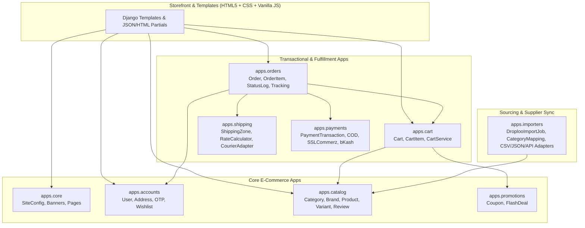
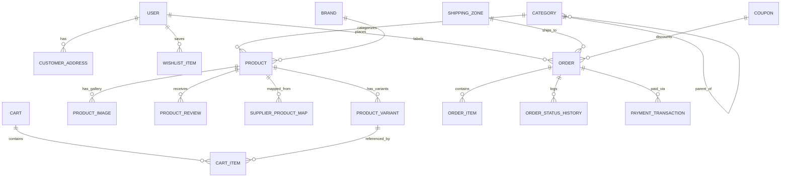

# DeenyaMart — Production E-Commerce Implementation Plan & Architecture Blueprint

> **Role & Scope**: Senior Django Full-Stack Engineering, E-Commerce Architecture, and UI/UX Design Specification  
> **Target Stack**: Python 3.12+ · Django 5.x · PostgreSQL 16+ · Semantic HTML5 · Modern CSS (Custom Properties, Grid, Subgrid, OKLCH) · Vanilla ES6+ JavaScript  
> **Shopping Experience Inspiration**: [kidsya.com](https://kidsya.com/) (reimagined with 100% original branding, layout composition, color tokens, and typography)  
> **Product Source Reference**: [droploo.com](https://droploo.com/) (via authorized CSV/JSON exports or permitted API feeds)

---

## 1. Repository & Reference Inspection Report

### 1.1 Existing Workspace & Tooling Audit
- **Workspace Status (`F:\DeenyaMart`)**: Verified empty directory (`Get-ChildItem -Force` returned 0 files/folders). No legacy code, migrations, or configuration files exist yet.
- **Inspection Methodology & Transparency**:
  - Headful browser rendering (`read_browser_page`) was not available in the active tool environment.
  - Initial page fetches via `read_url_content` and `curl` confirmed that both `https://kidsya.com/` and `https://droploo.com/` are client-rendered React/Vite Single Page Applications (`<main id="root"></main>` and `<div id="root"></div>`).
  - Rather than guessing or claiming visual inspection of unrendered DOM states, we inspected the publicly served static JavaScript/CSS bundles linked directly from each site's `index.html` and queried the public, unauthenticated read-only JSON endpoints that those bundles call on initial page load (`https://backend.kidsya.com/api/v2/*` and `https://backend.droploo.com/api/*`). No anti-bot protections were bypassed.

### 1.2 Verifiable Findings from `https://kidsya.com/`
1. **Platform Stack**: React + Vite SPA (`@tanstack/react-query`, `radix-ui`, `motion`, `swiper`, Tailwind CSS v4.1.14) communicating with an Active-eCommerce-style backend (`https://backend.kidsya.com/api/v2`).
2. **Verified Site Metadata (`/api/v2/metadata` & `/api/v2/business-settings`)**:
   - **Motto**: *"Your trusted online shopping destination for premium products, best deals & fast delivery all over Bangladesh."*
   - **Keywords**: `online shopping, khimar, hijab, kids hijab, kids khimar, woman hijab, woman khimar`
   - **Currency**: Bangladeshi Taka (`৳` / BDT, 2 decimal places).
   - **Active Payment Methods (`/api/v2/payment-types`)**: `cash_on_delivery` (*Cash on delivery*).
3. **Verified Category Taxonomy (`/api/v2/categories`)**:
   - `[400] Man's Cothing` *(source typo verified)* → Subcategories: `Jubba` `[408]`, `Panjabi` `[409]`, `Kabli` `[410]`
   - `[401] Woman Clothing` → Subcategories: `Woman Khimar`, `Woman Hijab`, `Woman Borka`, `Woman Jilbab`
   - `[402] Kids Clothing` → Subcategories: `Kids Hijab`, `Kids Khimar`, `KIds Borka` *(source casing typo verified)*
   - `[403] Gadget` → Subcategories: `[]`
   - `[404] Electronices` *(source typo verified)* → Subcategories: `[]`
   - `[405] Food` → Subcategories: `[]`
   - `[406] Kitchen` → Subcategories: `[]`
   - `[407] Home Tools` → Subcategories: `[]`
4. **Verified Top Brands / Fabric Groupings (`/api/v2/brands/top`)**:
   - `[74] cotton`, `[75] Lilen` *(Linen)*, `[76] Cherry`.
5. **Verified Catalog Samples (`/api/v2/products/home` & `/api/v2/home/categories/products`)**:
   - Modest apparel: *Kids Lilen Khimar Set KCK114* (`৳650.00`), *Lilen Fabric Khimar Set LF104* (`৳1,350.00`), *Cotton Semi Long Salat Hijab SH103* (`৳790.00`), *Kids Cherry Khimar Set KCKS123* (`৳988.00`), *Kids Cotton Khimar Set KCK110* (`৳590.00`).
   - Gadgets: *Hoco ES71 Platinum Wireless Neckband* (`৳1,000.00`, stroked `৳1,250.00`), *Watch 10 (Apple series)*.
6. **Verified Navigation, Routes & Conversion Patterns (from `/assets/index-_fPJ6vuV.js`)**:
   - **Navigation Structure**: Desktop utility header with live search suggestions (`/get-search-suggestions`), category menu, Wishlist badge (`/wishlist`), Cart drawer (`/cart`), Account menu (`/dashboard`), and a persistent Mobile Bottom Bar (`Home`, `Categories`, `Cart`, `Wishlist`, `Account`).
   - **Homepage Merchandising Blocks**: Hero banner carousel, `Shop by Category` strip, `Flash Deal` with live countdown (`Days`, `Hours`, `Minutes`, `Seconds`), `Best Sellers`, `Featured Products`, category-specific product rows (`/home/categories/products`), `Top Brands`, and a 4-item trust bar (`Value for money`, `Fast Delivery`, `Safe payments`, `National Delivery`).
   - **Dual-CTA Product Cards**: Cards display thumbnail, discount badge (`You save`), stroked vs. current price, stock badge, Wishlist button, `Add to cart`, and an immediate `Order now` CTA tailored for Bangladeshi mobile shoppers.
   - **Checkout & Order Flow**: Phone-first checkout (`Name`, `Phone`, `Full Address`, `Shipping Method`, `Payment Method`, `Coupon Code`), 6-digit SMS OTP verification (`Order Confirmation OTP`), customer dashboard with loyalty points, and public order tracking (`/track-order/:id` showing `Processing` → `Picked Up` → `On the Way` → `Delivered`).
   - **Visual Tokens (from `/assets/index-B8_P1pFK.css`)**: Uses Tailwind v4 `oklch` variables with an orange primary (`--primary: oklch(70.5% .213 47.604)`), system sans-serif stack, and `--radius: 0.65rem`.

### 1.3 Verifiable Findings from `https://droploo.com/`
1. **Platform Stack**: React + Redux Toolkit (`RTK Query`) with `baseUrl: "https://backend.droploo.com/api"`.
2. **Verified Category Taxonomy (`/api/categories`)**:
   - `[48] Home Decor` (`home-decor`)
   - `[50] Electronics` (`electronics`)
   - `[51] Life Style` (`life-style`)
   - `[52] Smart Gadgets` (`smart-gadgets`)
   - `[53] Metal Items` (`metal-items`)
   - `[54] All Foods` (`all-foods`)
   - `[55] Home & Kitchen` (`home-kitchen`)
   - `[56] Men's Fashions` (`mens-fashions`) → `Men's Panjabi`, `Men's Jubba`, `Men's Kabli`
   - `[57] Woman's Fashion` (`womans-fashion`) → `Woman Hijab`, `Woman Khimar`, `Woman Jilbab`, `Salat Hijab`
   - `[58] Kid's Fashion` (`kids-fashion`) → `Kids Jubba`, `Kids Panjabi`, `Kids Hijab`, `Kids Khimar`, `Kids Borka`
3. **Verified Catalog Scale & Endpoints**:
   - `/api/all-products?page=1` reports `total: 366` products across `8` pages (`per_page: 50`).
   - `/api/type-products` groups catalog items into `hotProducts` (30), `newProducts` (25), `regularProducts` (30), and `discountProducts` (4).
   - `/api/product/details/{slug}` returns full product details, gallery images, variant prices/sizes/colors, and related items.
   - Cross-referencing product names and style codes (e.g., `KCK110`, `KCK114`, `P109`, `VCP108`) confirms that Kidsya's modest wear and gadget catalog is sourced from Droploo's supplier inventory.
4. **Verified Droploo Product Schema (43 Fields) & Real-World Data Quirks**:
   - **Fields**: `id`, `temp_id`, `is_custom`, `b_product_id`, `is_variable`, `cat_id`, `sub_cat_id`, `vendor_id`, `brand_id`, `name`, `slug`, `qty`, `regular_price`, `wholesale_price`, `discount_price`, `buy_price`, `inside_dhaka`, `outside_dhaka`, `product_code`, `stock`, `short_description`, `long_description`, `vat_tax`, `image`, `imageUrl`, `product_type`, `status`, `created_at`, `updated_at`, `product_address`, `shipping_to`, `shipping_charge`, `delivery_time`, `seo_title`, `seo_description`, `seo_keyword`, `policy`, `page_name`, `is_page_product`, `priority`, `video_link`, `drive_link`, `rating`.
   - **Data Quirk A — Variant Matrix Inside `product_images`**: When `is_variable == 1` (e.g., `id: 1738` *Kids Cotton Khimar Set KCK136*), the top-level `colors` and `sizes` arrays frequently contain `null` placeholders, while actual variant attributes (`size: "Age 1/2"`, `color`, `price: 590`, `wholesale_price: 340`, `imageUrl`) live inside each entry of `product_images`.
   - **Data Quirk B — Wholesale/Regular Price Anomalies**: Some variable products have parent `wholesale_price: 0` or a parent `wholesale_price` higher than the lowest variant's `regular_price` (e.g., `regular_price: 590`, `wholesale_price: 1000` on parent).
   - **Data Quirk C — Null `product_code` with Embedded Style Codes**: `product_code` is often `null`, while the alphanumeric SKU/style code (`VCP108`, `KCK136`, `CPB105`) is embedded at the end of `name` and `slug`.
   - **Data Quirk D — Unescaped Spaces in Media URLs**: Gallery image URLs often contain raw spaces (e.g., `.../galleryImage/1396618454Kids Cotton Khimar Set KCK136.jpg`).
   - **Data Quirk E — Raw HTML & Mixed Bengali/English Descriptions**: `long_description` contains HTML markup (`<h3>`, `<p>`, `<strong>`, `<br />`, entities) and Bengali copy, while `short_description` is commonly `null`.

---

## 2. Original Brand Identity & Frontend Design System

To capture the frictionless shopping flow of Kidsya while establishing a **100% original visual identity**, DeenyaMart uses an editorial **"Modern Heritage & Everyday Utility"** aesthetic—replacing Kidsya's generic orange utility look with a refined **Deep Emerald Cypress, Warm Alabaster Sand, and Terracotta Brass** palette.

### 2.1 Brand Identity Placeholder
- **Brand Name**: **DeenyaMart** (configurable via `SiteSettings` in Django Admin)
- **Brand Positioning**: Curated Modest Apparel, Family Essentials & Smart Home Living
- **Tagline**: *"Thoughtful Modest Wear & Everyday Essentials, Delivered Across Bangladesh."*
- **Logo Treatment**:
  - **Emblem**: An original geometric octagonal star interwoven with a minimalist architectural arch (rendered as an inline accessible `<svg>` with dual-tone Emerald `#0B4F3F` and Brass `#C88A36` strokes).
  - **Wordmark**: `Deenya` in bold geometric serif/humanist display (`weight: 700`, tight tracking `-0.03em`) paired with `Mart` in clean medium sans-serif with a subtle brass dot accent.

### 2.2 Color Palette (CSS Custom Properties in Hex & OKLCH)
All text/surface pairings are engineered to meet or exceed **WCAG 2.1 AA** (4.5:1 normal text, 3:1 UI components/large text).

| Token Name | Hex Fallback | OKLCH Value | Usage & Contrast Verification |
| :--- | :--- | :--- | :--- |
| `--dm-bg-canvas` | `#FAF7F2` | `oklch(97.6% 0.011 85.0)` | Warm Alabaster page background (reduces eye strain vs. stark `#FFF`) |
| `--dm-bg-surface` | `#FFFFFF` | `oklch(100% 0 0)` | Elevated product cards, drawers, checkout panels |
| `--dm-bg-subtle` | `#F1ECE1` | `oklch(94.1% 0.019 84.5)` | Category pills, filter sidebars, table headers |
| `--dm-text-primary` | `#14231E` | `oklch(22.5% 0.024 168.0)` | Deep Forest Ink body & heading text (**15.2:1** on surface) |
| `--dm-text-secondary` | `#4A5D55` | `oklch(45.8% 0.025 166.0)` | Muted metadata, breadcrumbs, SKU labels (**6.7:1** on surface) |
| `--dm-brand-primary` | `#0B4F3F` | `oklch(37.8% 0.076 172.5)` | Deep Emerald Cypress — primary buttons, active states (**9.4:1** with white text) |
| `--dm-brand-primary-hover` | `#083B2F` | `oklch(30.5% 0.064 172.5)` | Hover/active state for primary CTAs |
| `--dm-brand-accent` | `#C86D2D` | `oklch(62.4% 0.148 52.0)` | Warm Terracotta Amber — "Quick Order" CTA, flash deal highlights |
| `--dm-brand-gold` | `#B8862D` | `oklch(66.5% 0.126 78.0)` | Heritage Brass — badges, rating stars, featured borders |
| `--dm-border-subtle` | `#E2DDD2` | `oklch(89.5% 0.016 84.5)` | Hairline card borders and section dividers |
| `--dm-status-success` | `#166534` | `oklch(44.8% 0.119 151.3)` | In-stock indicator, verified purchase, order delivered |
| `--dm-status-warning` | `#B45309` | `oklch(55.5% 0.146 58.0)` | Low stock alert, pending COD confirmation |
| `--dm-status-danger` | `#B91C1C` | `oklch(50.5% 0.195 27.5)` | Form validation errors, discount tags, out-of-stock |

### 2.3 Typography Scale & Multilingual Support
Because product descriptions and customer inputs mix **English** and **Bengali (`বাংলা`)** with `৳` currency values:
- **Heading Font (`--dm-font-display`)**: `'Plus Jakarta Sans', 'Hind Siliguri', system-ui, sans-serif` (weights: `600`, `700`).
- **Body Font (`--dm-font-sans`)**: `'Inter', 'Hind Siliguri', system-ui, -apple-system, sans-serif` (weights: `400`, `500`, `600`).
- **Numeric / Price / SKU Font (`--dm-font-mono`)**: `'JetBrains Mono', ui-monospace, monospace` with `font-variant-numeric: tabular-nums` so prices (`৳1,350.00`), countdown timers, and order codes align cleanly.
- **Fluid Type Scale**:
  - `--dm-text-xs`: `0.75rem` (12px, line-height `1.4`)
  - `--dm-text-sm`: `0.875rem` (14px, line-height `1.5`)
  - `--dm-text-base`: `1rem` (16px, line-height `1.6`)
  - `--dm-text-lg`: `1.125rem` (18px, line-height `1.5`)
  - `--dm-text-xl`: `clamp(1.25rem, 1.1rem + 0.5vw, 1.5rem)`
  - `--dm-text-2xl`: `clamp(1.5rem, 1.3rem + 0.8vw, 2rem)`
  - `--dm-text-hero`: `clamp(2rem, 1.5rem + 2vw, 3.25rem)`

### 2.4 Layout Grid, Breakpoints & Original Page Composition
- **Container System**: Max-width `1360px` (`--dm-container-max`) with fluid horizontal padding `clamp(1rem, 3vw, 2.5rem)`.
- **Responsive Breakpoints**:
  - **Mobile (`< 768px`)**: 2-column product grid (`gap: 0.75rem`), collapsible slide-over filter drawer, sticky bottom navigation bar (`Home`, `Categories`, `Search`, `Cart Drawer`, `Track Order`), and sticky bottom PDP action bar.
  - **Tablet (`768px – 1023px`)**: 3-column product grid (`gap: 1.25rem`), condensed top utility bar, touch-friendly horizontal category ribbon.
  - **Desktop (`>= 1024px`)**: 4-to-5 column product grid (`gap: 1.5rem`), split editorial hero (65% main lookbook showcase + 35% dual stacked seasonal/flash-offer cards), persistent left facet sidebar on category/search pages.
- **Original Component Architecture (Semantic HTML + CSS + Vanilla JS)**:
  1. **Announcement & Trust Ribbon (`<aside class="dm-topbar">`)**: Displays nationwide COD availability, hotline link, and quick `Track Order` link.
  2. **Sticky Header (`<header class="dm-header">`)**: Brand SVG logo, accessible category mega-menu (`<nav aria-label="Main Categories">`), debounced live search combobox (`role="combobox"`, `aria-expanded`) fetching HTML/JSON suggestions via `fetch()`, Wishlist counter, and slide-over Cart Drawer trigger.
  3. **Editorial Asymmetric Hero (`<section class="dm-hero">`)**: Unlike Kidsya's full-width generic carousel, uses a CSS Grid bento layout: primary curated collection story on the left (`Modest Wear & Family Collections`) + live *"Spotlight Deal of the Day"* card with vanilla JS countdown timer on the right.
  4. **Visual Category Bento & Pill Strip**: Tactile arched category cards for *Women's Modest Wear*, *Men's Panjabi & Jubba*, *Kids' Modest Sets*, *Home & Kitchen*, and *Smart Gadgets*.
  5. **DeenyaMart Product Card (`<article class="dm-product-card">`)**:
     - `aspect-ratio: 4 / 5` image container with `loading="lazy"`, `decoding="async"`, hover secondary image crossfade, and top-left fabric/category tag (`Linen`, `Cotton`, `Cherry`) + discount pill (`-18%`).
     - Semantic heading `<h3><a href="...">`, star rating summary, tabular price block (`<ins class="dm-price-current">৳650</ins> <del class="dm-price-old">৳790</del>`), and a split action footer: icon button for **Add to Cart** + primary button for **Quick Buy / Select Size**.
  6. **Slide-Over Cart Drawer (`<dialog id="dm-cart-drawer">`)**: Native HTML `<dialog>` element enhanced with vanilla JS for zero-dependency focus trapping, Escape key handling, backdrop click close, quantity steppers, and live shipping zone estimator.

---

## 3. Clean Django Project Structure

```text
F:\DeenyaMart\
├── manage.py
├── pyproject.toml
├── .env.example
├── .gitignore
├── Dockerfile
├── docker-compose.yml
├── docs/
│   └── implementation-plan.md
├── requirements/
│   ├── base.txt
│   ├── local.txt
│   └── production.txt
├── config/
│   ├── __init__.py
│   ├── asgi.py
│   ├── wsgi.py
│   ├── urls.py
│   └── settings/
│       ├── __init__.py
│       ├── base.py
│       ├── local.py
│       ├── test.py
│       └── production.py
├── apps/
│   ├── __init__.py
│   ├── core/                # Site settings, banners, CMS pages, base models, healthcheck
│   ├── accounts/            # Custom User (phone/email), addresses, OTP service, wishlist
│   ├── catalog/             # Categories, brands, products, variants, images, reviews, search
│   ├── promotions/          # Coupons, flash deals, campaign collections
│   ├── cart/                # Session + DB cart, item validation, drawer endpoints
│   ├── shipping/            # Shipping zones (Inside/Sub/Outside Dhaka), rate calculator, couriers
│   ├── orders/              # Checkout flow, order state machine, tracking, invoices
│   ├── payments/            # COD, SSLCommerz, bKash adapters, payment logs, webhooks
│   └── importers/           # Droploo CSV/JSON/API import pipeline, category map, audit logs
├── templates/
│   ├── base.html
│   ├── includes/            # _topbar.html, _header.html, _footer.html, _cart_drawer.html, _mobile_nav.html
│   ├── components/          # _product_card.html, _pagination.html, _breadcrumbs.html, _rating.html
│   ├── core/                # home.html, page_detail.html, contact.html
│   ├── catalog/             # product_list.html, category_detail.html, product_detail.html, search_results.html
│   ├── cart/                # cart_detail.html, partials/cart_drawer_body.html
│   ├── orders/              # checkout.html, otp_verify.html, order_success.html, track_order.html, invoice.html
│   └── accounts/            # login.html, register.html, dashboard.html, order_history.html, wishlist.html
├── static/
│   ├── css/
│   │   ├── tokens.css       # Custom properties (colors, typography, spacing, shadows)
│   │   ├── base.css         # Reset, semantics, accessibility utilities
│   │   ├── layout.css       # Grid, header, footer, drawers, responsive containers
│   │   ├── components.css   # Cards, buttons, badges, forms, tabs, steppers
│   │   └── pages.css        # Page-specific compositions (Hero, PDP, Checkout)
│   ├── js/
│   │   ├── main.js          # Core init, mobile menu, dialog controller, toast notifications
│   │   ├── search.js        # Debounced live search autocomplete combobox
│   │   ├── cart.js          # Async add-to-cart, quantity stepper, drawer refresh, CSRF helper
│   │   ├── pdp.js           # Image gallery switcher, variant matrix selector (size/color -> price/stock)
│   │   ├── checkout.js      # Shipping zone live recalculation, coupon apply, OTP timer
│   │   └── countdown.js     # Flash deal countdown timers
│   └── img/
│       ├── logo.svg
│       ├── favicon.svg
│       └── placeholders/
└── tests/
    ├── conftest.py
    ├── factories.py
    ├── test_catalog.py
    ├── test_cart.py
    ├── test_checkout_orders.py
    ├── test_payments_shipping.py
    ├── test_importers.py
    └── test_accessibility_seo.py
```

---

## 4. Modular Django App Boundaries & Responsibilities



| App Name | Core Responsibilities | Public Service Interface | What It Must NOT Do |
| :--- | :--- | :--- | :--- |
| **`apps.core`** | Abstract `TimeStampedModel` & `UUIDModel`; `SiteSettings` singleton; Hero `Banner` & `ContentPage` (About, Return Policy, Privacy, Terms); `/healthz/` check; Sitemap & SEO context processors. | `get_site_settings()` | Must not contain catalog or order business logic. |
| **`apps.accounts`** | Custom `User` model supporting Bangladesh mobile numbers (`+8801[3-9]\d{8}`) and email; `CustomerAddress`; `PhoneOTP` generation/throttling; `WishlistItem`. | `OTPService`, `WishlistService` | Must not calculate cart totals or process payments. |
| **`apps.catalog`** | Self-referencing `Category` tree; `Brand` / Fabric taxonomy; `Product`, `ProductVariant`, `ProductImage`, `ProductReview`; PostgreSQL `SearchVectorField` + `GinIndex` search and faceted filtering. | `CatalogSearchService`, `InventoryService` | Must not know about Droploo raw JSON quirks (handled in `apps.importers`). |
| **`apps.promotions`** | `Coupon` validation (percentage/fixed, min spend, usage limits, expiry) and `FlashDeal` time-boxed campaigns. | `PromotionService.validate_coupon()`, `get_active_flash_deals()` | Must not mutate `Order` records directly. |
| **`apps.cart`** | Anonymous session-backed & authenticated user-backed `Cart` and `CartItem`; automatic cart merge on login; real-time stock & variant price verification. | `CartService` (`add`, `update_qty`, `remove`, `merge`, `get_summary`) | Must not create orders or charge payments. |
| **`apps.shipping`** | Configurable `ShippingZone` (e.g., *Inside Dhaka Metro* `৳60`, *Dhaka Sub-Area* `৳100`, *Outside Dhaka* `৳120`), product-specific shipping overrides, free-shipping thresholds, courier dispatch hooks. | `ShippingCalculator.calculate(cart, zone, address)` | Must not modify product catalog data. |
| **`apps.orders`** | Transactional `Order` creation (`transaction.atomic()` + `select_for_update()` on variant stock), `OrderItem` price/cost snapshots (preserving wholesale vs. retail margin), `OrderStatusHistory`, public tracking code (`DM-YYYYMMDD-XXXX`), printable HTML/PDF invoices. | `OrderCheckoutService.create_order()`, `OrderTrackingService` | Must not store raw payment gateway secrets or supplier import parsers. |
| **`apps.payments`** | Strategy-pattern payment providers (`CashOnDeliveryProvider`, `SSLCommerzProvider`, `BkashProvider`), `PaymentTransaction` ledger, idempotent webhook verification, refund logging. | `PaymentGatewayRegistry.initiate()`, `.verify_webhook()` | Must not bypass `OrderCheckoutService` to alter inventory. |
| **`apps.importers`** | Authorized ingestion from Droploo CSV exports, JSON dumps, or permitted REST feeds; `SupplierCategoryMap` (normalizing source typos like `"Man's Cothing"` → `"Men's Clothing"`); HTML sanitization; image downloading & URL encoding; `ImportJobLog`. | `DroplooImportPipeline.run(source)` | Must never bypass anti-bot protections or invent fake products. |

---

## 5. Database Model Outline (PostgreSQL-Optimized)

### 5.1 Entity-Relationship Diagram



### 5.2 Model Specifications by App

#### 1. `apps.accounts`
- **`User(AbstractUser)`**:
  - `id`: `BigAutoField` (PK)
  - `phone_number`: `CharField(max_length=16, unique=True, db_index=True)` — validated for BD format (`01[3-9]XXXXXXXX` normalized to `+8801...`)
  - `email`: `EmailField(blank=True, null=True, db_index=True)`
  - `full_name`: `CharField(max_length=150)`
  - `is_phone_verified`: `BooleanField(default=False)`
  - `loyalty_points`: `PositiveIntegerField(default=0)`
- **`CustomerAddress`**:
  - `user` (`FK -> User`), `label` (`Home`/`Office`), `recipient_name`, `phone_number`, `division`, `district`, `thana_upazila`, `street_address`, `postal_code`, `shipping_zone` (`FK -> shipping.ShippingZone`), `is_default` (`BooleanField`).
- **`PhoneOTP`**:
  - `phone_number` (`db_index=True`), `purpose` (`REGISTER`, `ORDER_CONFIRM`, `PASSWORD_RESET`), `code_hash` (PBKDF2/SHA256 hash of 6-digit OTP), `expires_at`, `attempts` (`PositiveSmallIntegerField`), `is_used` (`BooleanField`).
- **`WishlistItem`**:
  - `user` (`FK -> User`), `product` (`FK -> catalog.Product`), `created_at`.
  - `UniqueConstraint(fields=['user', 'product'], name='uniq_user_wishlist_product')`.

#### 2. `apps.catalog`
- **`Category`**:
  - `id`, `parent` (`Self FK, null=True, blank=True`), `name` (`CharField(120)`), `slug` (`SlugField(140, unique=True)`), `description`, `icon_svg` / `image`, `banner_image`, `is_active` (`BooleanField(default=True)`), `is_featured` (`BooleanField(default=False)`), `sort_order` (`PositiveIntegerField(default=0)`), `seo_title`, `seo_description`.
  - Indexes: `BTreeIndex(fields=['parent', 'is_active', 'sort_order'])`.
- **`Brand`**:
  - `id`, `name`, `slug` (`unique=True`), `logo`, `is_featured`, `is_active`.
- **`Product`**:
  - `id`, `uuid` (`UUIDField(default=uuid4, unique=True)`), `category` (`FK -> Category, PROTECT`), `brand` (`FK -> Brand, null=True, SET_NULL`)
  - `name` (`CharField(255)`), `slug` (`SlugField(280, unique=True)`), `sku_prefix` (`CharField(64, unique=True, db_index=True)`)
  - `has_variants` (`BooleanField(default=False)`)
  - `base_regular_price` (`DecimalField(10, 2)`), `base_sale_price` (`DecimalField(10, 2, null=True, blank=True)`), `wholesale_cost_price` (`DecimalField(10, 2, null=True, blank=True)` — internal admin-only field for margin tracking)
  - `short_description` (`TextField(blank=True)`), `description_html` (`TextField(blank=True)` — sanitized HTML)
  - `unit` (`CharField(20, default='PC')`), `weight_grams` (`PositiveIntegerField(default=300)`)
  - `inside_dhaka_shipping_override` (`DecimalField(8, 2, null=True, blank=True)`), `outside_dhaka_shipping_override` (`DecimalField(8, 2, null=True, blank=True)`)
  - `is_featured`, `is_new_arrival`, `is_hot_deal`, `is_active` (`BooleanField(default=True, db_index=True)`)
  - `rating_avg` (`DecimalField(3, 2, default=0.00)`), `rating_count` (`PositiveIntegerField(default=0)`), `total_sales` (`PositiveIntegerField(default=0)`)
  - `video_url` (`URLField(blank=True)`), `return_policy_text` (`TextField(blank=True)`), `seo_title`, `seo_description`, `seo_keywords`
  - `search_vector`: `SearchVectorField(null=True)` (PostgreSQL full-text search vector on `name`, `sku_prefix`, `short_description`).
  - **Constraints & Indexes**:
    - `CheckConstraint(check=Q(base_regular_price__gte=0), name='product_regular_price_non_negative')`
    - `CheckConstraint(check=Q(base_sale_price__isnull=True) | Q(base_sale_price__lte=F('base_regular_price')), name='product_sale_lte_regular')`
    - `GinIndex(fields=['search_vector'], name='product_search_gin_idx')`
    - `BTreeIndex(fields=['category', 'is_active', '-created_at'])`
- **`ProductVariant`**:
  -Every product has **at least one** `ProductVariant` (for simple products, a single default variant is created automatically so cart, inventory, and order line items always reference `ProductVariant` uniformly).
  - `id`, `product` (`FK -> Product, related_name='variants'`), `sku` (`CharField(80, unique=True, db_index=True)`)
  - `size_label` (`CharField(50, blank=True)` — e.g., `"Age 7/8"`, `"XL"`, `"Free Size"`), `color_label` (`CharField(50, blank=True)`), `color_hex` (`CharField(7, blank=True)`)
  - `retail_price` (`DecimalField(10, 2)`), `compare_at_price` (`DecimalField(10, 2, null=True, blank=True)`), `wholesale_price` (`DecimalField(10, 2, null=True, blank=True)`)
  - `stock_qty` (`PositiveIntegerField(default=0)`), `low_stock_threshold` (`PositiveSmallIntegerField(default=5)`), `is_active` (`BooleanField(default=True)`)
  - `image` (`FK -> ProductImage, null=True, blank=True, SET_NULL`).
- **`ProductImage`**:
  - `id`, `product` (`FK -> Product, related_name='images'`), `image` (`ImageField`), `external_source_url` (`URLField(max_length=500, blank=True)`), `alt_text` (`CharField(255)`), `is_primary` (`BooleanField(default=False)`), `sort_order` (`PositiveSmallIntegerField(default=0)`).
- **`ProductReview`**:
  - `id`, `product` (`FK -> Product`), `user` (`FK -> User`), `order_item` (`FK -> orders.OrderItem, null=True`), `rating` (`PositiveSmallIntegerField` 1..5), `comment`, `is_verified_purchase` (`BooleanField(default=False)`), `is_approved` (`BooleanField(default=False)`).

#### 3. `apps.promotions`
- **`Coupon`**:
  - `code` (`CharField(40, unique=True, db_index=True)`), `discount_type` (`PERCENTAGE` / `FIXED`), `discount_value` (`DecimalField(10, 2)`), `max_discount_amount` (`DecimalField(10, 2, null=True)`), `min_order_amount` (`DecimalField(10, 2, default=0)`), `valid_from`, `valid_until`, `usage_limit`, `used_count`, `is_active`.
- **`FlashDeal` & `FlashDealItem`**:
  - `title`, `slug`, `banner_image`, `starts_at`, `ends_at`, `is_active`; items link `Product` with `promotional_price` or `discount_percent`.

#### 4. `apps.cart`
- **`Cart`**:
  - `id` (`UUIDField(primary_key=True)`), `user` (`OneToOneField -> User, null=True, blank=True`), `session_key` (`CharField(64, db_index=True, blank=True)`), `coupon` (`FK -> promotions.Coupon, null=True, SET_NULL`), `shipping_zone` (`FK -> shipping.ShippingZone, null=True, SET_NULL`), `created_at`, `updated_at`.
- **`CartItem`**:
  - `cart` (`FK -> Cart, related_name='items'`), `variant` (`FK -> catalog.ProductVariant`), `quantity` (`PositiveSmallIntegerField(default=1)`).
  - `UniqueConstraint(fields=['cart', 'variant'], name='uniq_cart_variant')`.

#### 5. `apps.shipping`
- **`ShippingZone`**:
  - `code` (`INSIDE_DHAKA`, `SUB_DHAKA`, `OUTSIDE_DHAKA`), `name` (e.g., *"Inside Dhaka City"*, *"Dhaka Sub-Urban (Savar, Keraniganj, Gazipur, Narayanganj)"*, *"Outside Dhaka (All Districts)"*), `base_rate` (`DecimalField(8, 2)` — e.g., `60.00`, `100.00`, `120.00`), `free_shipping_threshold` (`DecimalField(10, 2, null=True)`), `estimated_delivery_days` (`CharField(50)` — e.g., `"1-2 Business Days"`), `is_active`.

#### 6. `apps.orders`
- **`Order`**:
  - `id`, `order_number` (`CharField(24, unique=True, db_index=True)` — e.g., `DM-20261017-8492`)
  - `user` (`FK -> User, null=True, blank=True, SET_NULL`)
  - Customer Snapshot: `customer_name`, `customer_phone` (`db_index=True`), `customer_email`, `shipping_address_line`, `shipping_area`, `shipping_district`, `shipping_zone` (`FK -> ShippingZone, PROTECT`), `order_notes`
  - Financials: `subtotal_amount`, `discount_amount`, `shipping_amount`, `tax_amount`, `grand_total` (`DecimalField(10, 2)`), `coupon_code_snapshot`
  - Status & Verification:
    - `status`: `PENDING_OTP`, `CONFIRMED`, `PROCESSING`, `PACKED`, `HANDED_TO_COURIER` (*Picked Up*), `IN_TRANSIT` (*On the Way*), `DELIVERED`, `CANCELLED`, `RETURNED`
    - `payment_status`: `UNPAID`, `PARTIALLY_PAID`, `PAID`, `REFUNDED`, `FAILED`
    - `payment_method`: `COD`, `SSLCOMMERZ`, `BKASH`
    - `is_otp_verified` (`BooleanField(default=False)`)
    - `courier_name`, `courier_tracking_code`
- **`OrderItem`**:
  - `order` (`FK -> Order, related_name='items'`), `product` (`FK -> Product, PROTECT`), `variant` (`FK -> ProductVariant, PROTECT`)
  - Immutable Snapshots: `product_name_snapshot`, `variant_label_snapshot`, `sku_snapshot`, `unit_retail_price`, `unit_wholesale_cost`, `quantity`, `line_total`.
- **`OrderStatusHistory`**:
  - `order` (`FK -> Order`), `from_status`, `to_status`, `note`, `changed_by` (`FK -> User, null=True`), `created_at`.

#### 7. `apps.payments`
- **`PaymentTransaction`**:
  - `id` (`UUIDField`), `order` (`FK -> Order, related_name='transactions'`), `provider` (`COD`, `SSLCOMMERZ`, `BKASH`), `gateway_transaction_id` (`CharField(128, db_index=True, blank=True)`), `amount` (`DecimalField(10, 2)`), `currency` (`default='BDT'`), `status` (`INITIATED`, `SUCCESS`, `FAILED`, `CANCELLED`, `REFUNDED`), `raw_response_json` (`JSONField(default=dict)`), `created_at`, `updated_at`.

#### 8. `apps.importers`
- **`SupplierCategoryMap`**:
  - `source_name` (`default='droploo'`), `external_category_id` (`IntegerField`), `external_subcategory_id` (`IntegerField(null=True)`), `external_name` (`CharField(150)`), `external_slug` (`CharField(150)`), `mapped_category` (`FK -> catalog.Category`).
  - `UniqueConstraint(fields=['source_name', 'external_category_id', 'external_subcategory_id'], name='uniq_supplier_cat_map')`.
- **`SupplierProductMap`**:
  - `source_name` (`default='droploo'`), `external_product_id` (`IntegerField(db_index=True)`), `external_slug` (`CharField(280)`), `product` (`OneToOneField -> catalog.Product`), `raw_payload_hash` (`CharField(64)` — SHA256 digest to skip unchanged records), `raw_payload_snapshot` (`JSONField`), `last_synced_at`.
- **`ImportJobLog`**:
  - `id` (`UUIDField`), `source_type` (`CSV_FILE`, `JSON_FILE`, `AUTHORIZED_API`), `source_reference` (file path or feed name), `status` (`RUNNING`, `COMPLETED`, `COMPLETED_WITH_ERRORS`, `FAILED`), `total_records`, `created_count`, `updated_count`, `skipped_count`, `error_count`, `error_report_json` (`JSONField(default=list)`), `started_at`, `finished_at`, `triggered_by` (`FK -> User, null=True`).

---

## 6. Complete URL Map & View Architecture

| URL Pattern | View / Handler | Name | Method(s) | Purpose & Response Format |
| :--- | :--- | :--- | :--- | :--- |
| `/` | `core.views.HomeView` | `core:home` | `GET` | Homepage: asymmetric editorial hero, flash deal, category showcase, curated shelves, trust strip |
| `/healthz/` | `core.views.HealthCheckView` | `core:healthz` | `GET` | JSON readiness probe (verifies DB connectivity & cache) |
| `/pages/<slug:slug>/` | `core.views.ContentPageDetailView` | `core:page_detail` | `GET` | About Us, Privacy Policy, Return Policy, Terms & Conditions |
| `/shop/` | `catalog.views.ProductListView` | `catalog:product_list` | `GET` | Full catalog with faceted filtering (category, brand/fabric, price range, stock, sort) + pagination |
| `/category/<slug:slug>/` | `catalog.views.CategoryDetailView` | `catalog:category_detail` | `GET` | Category landing page with subcategory pills, breadcrumbs, and filtered product grid |
| `/product/<slug:slug>/` | `catalog.views.ProductDetailView` | `catalog:product_detail` | `GET` | Product Detail Page (PDP): gallery, variant matrix JSON, shipping estimator, tabs, related products |
| `/search/` | `catalog.views.SearchView` | `catalog:search` | `GET` | Full search results page using PostgreSQL `SearchVector` + trigram fallback |
| `/search/suggestions/` | `catalog.views.SearchSuggestionsView` | `catalog:search_suggestions` | `GET` | Lightweight JSON/HTML partial for live header autocomplete combobox |
| `/deals/` | `promotions.views.FlashDealListView` | `promotions:deals` | `GET` | Active flash deals and promotional campaigns with countdown |
| `/cart/` | `cart.views.CartDetailView` | `cart:detail` | `GET` | Full shopping cart page with shipping zone selector & coupon input |
| `/cart/drawer/` | `cart.views.CartDrawerPartialView` | `cart:drawer_partial` | `GET` | HTML partial rendered inside the slide-over `<dialog>` cart drawer |
| `/cart/add/` | `cart.views.CartAddView` | `cart:add` | `POST` | Adds variant + qty to cart; supports `buy_now=1` redirect directly to `/checkout/` |
| `/cart/update/` | `cart.views.CartUpdateQtyView` | `cart:update` | `POST` | Updates line item quantity or removes item (`qty=0`); returns updated totals JSON + HTML fragment |
| `/cart/coupon/apply/` | `cart.views.CartApplyCouponView` | `cart:apply_coupon` | `POST` | Validates and attaches coupon to active cart |
| `/cart/coupon/remove/` | `cart.views.CartRemoveCouponView` | `cart:remove_coupon` | `POST` | Detaches active coupon from cart |
| `/checkout/` | `orders.views.CheckoutView` | `orders:checkout` | `GET, POST` | Single-page high-conversion checkout (address, shipping zone rate calculation, payment method) |
| `/checkout/shipping-quote/` | `shipping.views.ShippingQuoteView` | `shipping:quote` | `GET` | Returns JSON shipping fee & grand total when customer switches Inside/Sub/Outside Dhaka |
| `/checkout/verify-otp/<str:order_number>/` | `orders.views.OrderOTPVerifyView` | `orders:verify_otp` | `GET, POST` | 6-digit phone OTP verification step for COD orders (with resend cooldown) |
| `/order/success/<str:order_number>/` | `orders.views.OrderSuccessView` | `orders:success` | `GET` | Order confirmation receipt with item summary, tracking code, and printable invoice button |
| `/order/invoice/<str:order_number>/` | `orders.views.OrderInvoiceView` | `orders:invoice` | `GET` | Print-optimized semantic HTML/PDF invoice |
| `/track-order/` | `orders.views.OrderTrackView` | `orders:track` | `GET` | Public order tracker by `order_number` + `customer_phone` (4-stage visual progress bar) |
| `/payments/initiate/<str:order_number>/` | `payments.views.PaymentInitiateView` | `payments:initiate` | `POST` | Redirects to SSLCommerz / bKash gateway or finalizes COD |
| `/payments/webhook/<str:provider>/` | `payments.views.PaymentWebhookView` | `payments:webhook` | `POST` | CSRF-exempt, signature-verified idempotent IPN/webhook handler |
| `/accounts/login/` | `accounts.views.LoginView` | `accounts:login` | `GET, POST` | Phone number or email + password authentication |
| `/accounts/register/` | `accounts.views.RegisterView` | `accounts:register` | `GET, POST` | Customer registration with phone normalization |
| `/accounts/logout/` | `accounts.views.LogoutView` | `accounts:logout` | `POST` | Secure POST-only logout |
| `/accounts/password-reset/` | `accounts.views.PasswordResetFlowView` | `accounts:password_reset` | `GET, POST` | Phone OTP / email password reset workflow |
| `/accounts/dashboard/` | `accounts.views.DashboardView` | `accounts:dashboard` | `GET` | Customer overview (order counts, recent orders, saved addresses, loyalty points) |
| `/accounts/orders/` | `accounts.views.OrderHistoryView` | `accounts:orders` | `GET` | Paginated purchase history with status filters |
| `/accounts/wishlist/` | `accounts.views.WishlistView` | `accounts:wishlist` | `GET` | Customer saved wishlist items |
| `/accounts/wishlist/toggle/` | `accounts.views.WishlistToggleView` | `accounts:wishlist_toggle` | `POST` | Async toggle product in wishlist |
| `/reviews/submit/<slug:product_slug>/` | `catalog.views.SubmitReviewView` | `catalog:submit_review` | `POST` | Authenticated customer review submission |
| `/sitemap.xml` | `django.contrib.sitemaps.views.sitemap` | `sitemap` | `GET` | Dynamic XML sitemap for categories, products, and CMS pages |
| `/admin/` | `django.contrib.admin` | `admin:index` | `GET, POST` | Customized Django Admin with import job runner, order fulfillment actions, and margin reports |

---

## 7. Droploo Catalog Ingestion Pipeline Architecture

### 7.1 Ethical & Authorized Ingestion Policy
- **Primary Ingestion Modes**:
  1. **Local CSV / JSON File Import (`python manage.py import_droploo_catalog --file path/to/export.json|.csv`)**: Built as the default, zero-dependency, deterministic pipeline that works offline or in CI/CD using exported supplier files or Django Admin file uploads.
  2. **Authorized REST Feed Adapter (`--source authorized-api`)**: Optional adapter configurable via environment variables (`DROPLOO_API_BASE_URL`, `DROPLOO_API_KEY` / authorized partner token) with strict rate-limiting, exponential backoff, and custom `User-Agent` identification.
- **Strict Guardrails**: Never bypasses CAPTCHAs, Cloudflare challenges, or authentication walls; never fabricates synthetic product records when a feed is unavailable.

### 7.2 Source-to-Target Field Mapping & Normalization Rules
Based on the 43 fields verified in Droploo's catalog payloads (`/api/type-products` and `/api/product/details/{slug}`):

| Droploo Source Field(s) | DeenyaMart Target Model & Field | Normalization & Cleansing Rule |
| :--- | :--- | :--- |
| `id` | `SupplierProductMap.external_product_id` | Stored as integer external key for idempotent upserts. |
| `cat_id`, `sub_cat_id`, `category.name` | `Product.category` (via `SupplierCategoryMap`) | Maps Droploo category IDs (`48..58` and subcategories) to clean DeenyaMart categories (e.g., `"Men's Fashions"` → `"Men's Modest Wear"`, `"Woman's Fashion"` → `"Women's Modest Wear"`, `"Kid's Fashion"` → `"Kids' Modest Wear"`). |
| `name`, `slug` | `Product.name`, `Product.slug` | Trims excess whitespace; ensures unique slug via deterministic suffix if collision occurs. |
| `product_code` (or regex suffix of `name`) | `Product.sku_prefix` & `ProductVariant.sku` | If `product_code` is `null` (verified common on Droploo), extracts trailing style code (e.g., `KCK136`, `VCP108`, `P109`) or generates `DRP-{id}`. |
| `regular_price`, `discount_price` | `Product.base_regular_price`, `Product.base_sale_price` | Converts to `Decimal(10, 2)`. If `discount_price` is `0`, `null`, or `>= regular_price`, sets `base_sale_price = None`. |
| `wholesale_price` | `Product.wholesale_cost_price` | Stored for internal margin calculation. If `wholesale_price == 0` or `> regular_price` on a parent variable product (verified quirk on `id: 1738`), derives cost from variant-level `wholesale_price` inside `product_images`. |
| `is_variable`, `product_images`, `colors`, `sizes` | `Product.has_variants`, `ProductVariant` | **Critical Quirk Handler**: When `is_variable == 1`, inspects `product_images` entries first (which carry per-variant `size`, `color`, `price`, `wholesale_price`, `imageUrl`). Filters out `null` entries from `colors`/`sizes`. If `is_variable == 0`, creates 1 default `ProductVariant` with `stock_qty = qty or stock or 0`. |
| `imageUrl`, `product_images[].imageUrl` | `ProductImage` | URL-encodes raw spaces in filenames (`urllib.parse.quote(path, safe='/:')`) before downloading or validating; generates descriptive `alt_text` from product name + variant label. |
| `short_description`, `long_description` | `Product.short_description`, `Product.description_html` | Sanitizes `long_description` HTML with allowlisted tags (`p`, `h3`, `h4`, `ul`, `ol`, `li`, `strong`, `em`, `br`). Auto-generates plain-text `short_description` (160 chars) if source `short_description` is `null`. |
| `inside_dhaka`, `outside_dhaka`, `shipping_charge` | `Product.inside_dhaka_shipping_override`, `outside_dhaka_shipping_override` | Populated only if positive numeric value is provided; otherwise `None` (falls back to `ShippingZone.base_rate`). |
| `product_type` (`hot`, `new`, `feature`, `discount`) | `is_hot_deal`, `is_new_arrival`, `is_featured` | Maps boolean merchandising flags for homepage shelves. |

---

## 8. Integration, Operational & Technical Risks

| # | Risk Category | Specific Verified Risk | Architectural Mitigation |
| :--- | :--- | :--- | :--- |
| **R1** | **Supplier Data Integrity** | Droploo variable products store variant prices/sizes inside `product_images` while `colors`/`sizes` arrays contain `null` records; parent `wholesale_price` is occasionally inverted (`1000` vs `590` retail) or `0`. | Implement a dedicated `DroplooPayloadNormalizer` with Pydantic/dataclass schema validation before touching the ORM. Reject or flag negative margins in `ImportJobLog` so retail prices are never under-priced below wholesale cost. |
| **R2** | **Broken Media URLs** | Verified Droploo gallery URLs contain unescaped spaces (`1396618454Kids Cotton Khimar Set KCK136.jpg`) and third-party hotlinking can fail or slow down LCP. | Normalize URLs with `urllib.parse.quote`, download product images asynchronously into local/S3-compatible media storage during import, and generate WebP thumbnails with fallback SVG placeholders. |
| **R3** | **Inventory Drift (Dropshipping)** | Supplier stock on Droploo changes independently of storefront orders, risking overselling during Flash Deals. | Maintain a configurable `safety_stock_buffer` (e.g., mark variant out-of-stock when supplier `qty <= 3`) and support scheduled/on-demand delta imports via `raw_payload_hash` comparison. |
| **R4** | **COD Fraud & Fake Orders** | In Bangladesh e-commerce, Cash on Delivery (`COD`) accounts for >80% of orders (and is the sole active method on Kidsya), making stores vulnerable to fake phone numbers and prank orders. | Enforce strict BD mobile regex validation (`^(\+?880|0)1[3-9]\d{8}$`), rate-limited 6-digit phone OTP verification (`PENDING_OTP` → `CONFIRMED`), IP/phone velocity throttling, and admin repeat-customer trust scoring. |
| **R5** | **Payment Webhook Race Conditions** | Customer browser redirect and asynchronous gateway IPN (SSLCommerz / bKash) may arrive simultaneously. | Wrap payment state transitions in `transaction.atomic()` with `select_for_update()` on `Order` and `PaymentTransaction`, keyed by idempotent `gateway_transaction_id`. |
| **R6** | **Catalog N+1 Query Bottlenecks** | Rendering 20+ product cards per page with primary/hover images, category names, variant price ranges, and wishlist states can trigger 80+ SQL queries. | Enforce a centralized `ProductQuerySet.with_card_data()` manager method using `select_related('category', 'brand')`, `prefetch_related('images', 'variants')`, and annotated wishlist state. Assert query counts in automated tests (`django_assert_max_num_queries`). |

---

## 9. Security, Accessibility, Performance & Deployment Readiness

### 9.1 Security Architecture
- **Environment & Secrets**: 12-Factor configuration via `environ` / `os.environ` (`DJANGO_SECRET_KEY`, `DATABASE_URL`, `ALLOWED_HOSTS`, `CSRF_TRUSTED_ORIGINS`); zero hardcoded secrets.
- **Production Hardening (`config/settings/production.py`)**:
  - `DEBUG = False`, `SECURE_SSL_REDIRECT = True`, `SESSION_COOKIE_SECURE = True`, `CSRF_COOKIE_SECURE = True`, `SESSION_COOKIE_HTTPONLY = True`, `SECURE_HSTS_SECONDS = 31536000`, `SECURE_CONTENT_TYPE_NOSNIFF = True`, `X_FRAME_OPTIONS = 'DENY'`.
- **Input & HTML Sanitization**: All supplier-imported HTML (`description_html`) is stripped of `<script>`, `<iframe>`, `<object>`, and inline `on*` event attributes using `nh3` / `bleach` at ingestion time; customer reviews and order notes are strictly escaped via Django's template autoescaping.
- **Rate Limiting**: Login, registration, OTP generation/verification, and checkout submission endpoints are protected by cache-backed rate limiting (IP + phone numbersliding window).

### 9.2 Accessibility (WCAG 2.1 Level AA)
- **Semantic Landmarks**: `<header>`, `<nav aria-label="...">`, `<main id="main-content">`, `<aside>`, `<section aria-labelledby="...">`, `<footer>`, plus a visible-on-focus **"Skip to main content"** link.
- **Keyboard & Screen Reader Support**:
  - Native `<dialog>` for Cart Drawer and Quick-Buy modals with full focus return to trigger button on close.
  - Live `aria-live="polite"` region announcing cart additions (`"Added Kids Cotton Khimar Set (Age 7/8) to cart"`), coupon results, and shipping total updates.
  - Explicit `<label for="...">` and `aria-describedby` error messages on every checkout and auth input.
  - Respects `@media (prefers-reduced-motion: reduce)` by disabling carousel auto-scroll and smooth-scroll animations.

### 9.3 Performance Engineering
- **Database**: PostgreSQL 16 in production (`CONN_MAX_AGE = 60`, composite B-Tree indexes on filter columns, GIN index on `search_vector`).
- **Frontend Asset Delivery**: Zero heavy JS framework bundles. Total custom JS payload target `< 25 KB` gzipped; CSS served via WhiteNoise with Brotli/Gzip compression and immutable content-hashed filenames (`ManifestStaticFilesStorage`).
- **Images**: Explicit `width` and `height` attributes on all `` tags to eliminate Cumulative Layout Shift (`CLS < 0.05`); `fetchpriority="high"` on the hero banner and PDP primary image; `loading="lazy"` on below-the-fold product cards.

---

## 10. Phased Development Sequence

| Phase | Milestone | Scope & Key Deliverables | Verification Gate |
| :--- | :--- | :--- | :--- |
| **Phase 1** | **Foundation, Config & Accounts** | Initialize Django project structure, split settings (`base`, `local`, `test`, `production`), PostgreSQL + SQLite test fallback config, `apps.core` (`SiteSettings`, `Banner`, `ContentPage`, `/healthz/`), and `apps.accounts` (Custom `User` with BD phone auth, `CustomerAddress`, `PhoneOTP`). | `pytest tests/test_accounts.py` passes; `/healthz/` returns `200 OK`; `manage.py check --deploy` passes. |
| **Phase 2** | **Catalog Domain & Droploo Ingestion Pipeline** | Build `apps.catalog` (`Category`, `Brand`, `Product`, `ProductVariant`, `ProductImage`, `ProductReview`) and `apps.importers` (`SupplierCategoryMap`, `SupplierProductMap`, `ImportJobLog`, `import_droploo_catalog` management command + sample fixture matching real Droploo schema). | Import command ingests sample CSV & JSON files idempotently, resolves `product_images` variants, sanitizes HTML, and passes `tests/test_importers.py`. |
| **Phase 3** | **Design System & Storefront Discovery UI** | Implement original DeenyaMart CSS design system (`tokens.css`, `base.css`, `layout.css`, `components.css`), `base.html`, Homepage (`HomeView`), Category page, Faceted Shop page, Search + live autocomplete, and Product Detail Page (`PDP`) with vanilla JS variant selector. | All storefront pages render semantic HTML, responsive layouts across mobile/tablet/desktop, and pass max SQL query count assertions. |
| **Phase 4** | **Cart, Promotions & Shipping Engine** | Implement `apps.promotions` (`Coupon`, `FlashDeal`), `apps.shipping` (`ShippingZone`: Inside Dhaka, Sub-Dhaka, Outside Dhaka + calculator), and `apps.cart` (Session/DB cart, slide-over `<dialog>` Cart Drawer, async add/update/remove, cart merge on login). | Cart operations, coupon calculations, and shipping zone quotes pass `tests/test_cart.py` and `tests/test_payments_shipping.py`. |
| **Phase 5** | **Checkout, Orders, OTP, Payments & Admin** | Implement `apps.orders` (`CheckoutView`, atomic stock deduction, `OrderOTPVerifyView`, `OrderTrackView`, printable invoice) and `apps.payments` (`COD`, `SSLCommerz`, `bKash` strategy providers + webhook endpoint), plus rich Django Admin dashboards. | Full end-to-end checkout → OTP verification → payment → order tracking flow passes `tests/test_checkout_orders.py`. |
| **Phase 6** | **Hardening, Accessibility, SEO & Deployment Packaging** | Add XML sitemaps, OpenGraph/JSON-LD `Product` structured data, rate limiting, `Dockerfile`, `docker-compose.yml` (Django + PostgreSQL 16 + Nginx/WhiteNoise), and full test suite coverage verification. | Complete test suite green (`pytest`), zero unapplied migrations, deployment checklist verified. |

---

## 11. Checklist of Verifiable Acceptance Criteria

### A. Architecture, Configuration & Security
- [ ] **AC-1.1**: Project follows the modular layout (`config/settings/{base,local,test,production}.py` and `apps/{core,accounts,catalog,promotions,cart,shipping,orders,payments,importers}`).
- [ ] **AC-1.2**: Production settings configure PostgreSQL via `DATABASE_URL` and enforce `DEBUG=False`, `SECURE_HSTS_SECONDS`, `SESSION_COOKIE_SECURE`, `CSRF_COOKIE_SECURE`, `SECURE_CONTENT_TYPE_NOSNIFF`, and `X_FRAME_OPTIONS='DENY'`.
- [ ] **AC-1.3**: `GET /healthz/` verifies database connectivity and returns HTTP `200` with JSON `{"status": "ok"}`.

### B. Original Brand & Frontend Design System
- [ ] **AC-2.1**: Storefront uses original **DeenyaMart** branding, custom inline SVG geometric emblem, and the Deep Emerald (`#0B4F3F`), Warm Alabaster (`#FAF7F2`), and Terracotta (`#C86D2D`) color system—with zero copied logos, text, or layout clones from Kidsya or Droploo.
- [ ] **AC-2.2**: All CSS uses modern native features (CSS Custom Properties, Grid, Flexbox, fluid `clamp()` typography) and vanilla ES6 JavaScript with no React/Vue/Tailwind build dependency required.
- [ ] **AC-2.3**: Storefront is responsive across Mobile (`375px` with sticky bottom nav & collapsible filter drawer), Tablet (`768px`), and Desktop (`1280px+`), and includes keyboard-accessible `<dialog>` drawers, skip links, and `aria-live` announcements.

### C. Droploo Catalog Ingestion Pipeline
- [ ] **AC-3.1**: `python manage.py import_droploo_catalog --file <path.json|path.csv>` imports categories, products, variants, and images idempotently (re-running the same file produces `0` duplicate products/variants and records an `ImportJobLog`).
- [ ] **AC-3.2**: Source category typos (e.g., `"Man's Cothing"`, `"Electronices"`, `"KIds Borka"`, `"Men's Fashions"`) are normalized through `SupplierCategoryMap` into clean storefront categories.
- [ ] **AC-3.3**: Variable products (`is_variable=1`) extract size, color, retail price, and wholesale cost accurately from `product_images` entries while ignoring `null` placeholders in `colors`/`sizes`.
- [ ] **AC-3.4**: Supplier `long_description` HTML is sanitized against XSS (`<script>`, `onerror`, `<iframe>` stripped), and image URLs containing spaces are properly URL-encoded.

### D. Catalog Discovery, Search & Filtering
- [ ] **AC-4.1**: Category and Shop pages support multi-facet filtering (`category`, `brand`, `min_price`, `max_price`, `in_stock`, `on_sale`) and sorting (`newest`, `price_asc`, `price_desc`, `best_selling`) while preserving query parameters across pagination.
- [ ] **AC-4.2**: `GET /search/?q=<term>` and `GET /search/suggestions/?q=<term>` return matching products by name, category, or SKU code (`KCK114`, `VCP108`, etc.).
- [ ] **AC-4.3**: Product Detail Page (`/product/<slug>/`) renders JSON-LD `Product` schema, image gallery, dynamic variant price/stock switcher, shipping cost preview for Inside/Outside Dhaka, and customer reviews.
- [ ] **AC-4.4**: Catalog list and homepage views execute in a bounded number of SQL queries (no N+1 queries as product count grows).

### E. Cart, Promotions, Shipping, Checkout & Orders
- [ ] **AC-5.1**: Anonymous and authenticated shoppers can add variants to the cart, adjust quantities, remove items, and use `"Quick Buy / Order Now"` to jump straight to checkout; anonymous carts merge cleanly upon login.
- [ ] **AC-5.2**: Valid coupons apply percentage or fixed discounts respecting `min_order_amount`, `max_discount_amount`, and expiry dates; invalid/expired coupons return clear validation feedback.
- [ ] **AC-5.3**: Shipping calculator accurately computes delivery fees for *Inside Dhaka*, *Dhaka Sub-Urban*, and *Outside Dhaka*, honoring product-level shipping overrides and free-shipping thresholds.
- [ ] **AC-5.4**: Submitting checkout runs inside an atomic transaction with row-level stock locking (`select_for_update`), decrements `ProductVariant.stock_qty`, snapshots retail and wholesale prices onto `OrderItem`, and generates a unique `DM-YYYYMMDD-XXXX` order number.
- [ ] **AC-5.5**: Cash on Delivery (`COD`) orders support 6-digit phone OTP confirmation (`PENDING_OTP` → `CONFIRMED`), while online payment orders (`SSLCommerz` / `bKash`) verify webhook signatures idempotently.
- [ ] **AC-5.6**: Customers can track order progression (`CONFIRMED` → `PROCESSING` → `HANDED_TO_COURIER` → `IN_TRANSIT` → `DELIVERED`) via `/track-order/` using their order number and phone number, and view/print invoices.

### F. Customer Accounts & Django Admin
- [ ] **AC-6.1**: Customers can register, log in with BD phone number or email, manage addresses, toggle wishlist items, and view order history in `/accounts/dashboard/`.
- [ ] **AC-6.2**: Django Admin provides inline variant/image editing, bulk order status transitions, profit margin visibility (`unit_retail_price - unit_wholesale_cost`), and one-click CSV/JSON catalog import execution with audit logs.
